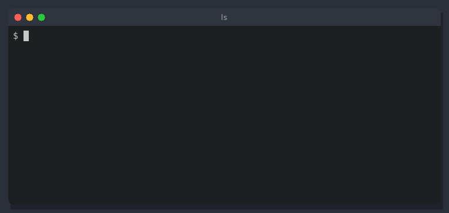

# autodemo

Scripted, non-interactive demo recorder for GitHub READMEs. You write a small `*.demo` script,
autodemo drives the program (typed keys, simulated mouse pointer, captions, slides, transitions)
and renders an **animated WebP** (or mp4/webm). Written in C, links freetype + libwebp.

## Status (honest)

| Part | State |
|---|---|
| Script parser, `check` | done, tested |
| TUI/CLI backend (private tmux + software renderer) | done, tested on `ls`, frost, lazytui |
| Animated WebP (libwebp anim encoder, frame dedup, lossless or lossy) | done |
| mp4 / webm via ffmpeg | done (needs ffmpeg) |
| `preview` (ASCII key screens) | done |
| GUI backend (`Window gui`): tiny headless Wayland compositor built into the binary, no external tools | works with foot, filem8, Qt (PySide6) and Firefox (clicks in web content, `<select>` popup); popups, dialogs, `WaitFor title\|settle`: see docs/gui.md |
| `Audio "x.mp3" [volume]` | done: sound track under mp4/webm (looped, faded out at the end); webp has no sound and says so |
| `autodemo rec OUT.demo` | done: you play the scenario by hand, it writes the `.demo` (keys, pauses, mouse with `--mouse`) |
| Emacs mode | not started; the format is plain line-based on purpose |

Limits: wide (CJK) glyphs take one cell, no italics, no blinking cursor, no bold face for
non-ASCII fallback, text fonts are DejaVu (override the mono font with `AUTODEMO_FONT=/x.ttf`).
Recording is real time (a 10 s demo takes ~10 s). Per-run temp dirs `/tmp/autodemo-home-*`
are left behind (tiny); delete them yourself.

## gen / auto (demo without writing a script)

`autodemo gen PROGRAM` (name or path) writes a normal `.demo`: a fixture project in the private HOME, the `--help` screen and up to
3 commands from the man page EXAMPLES section. It never overwrites a hand-written demo. Man examples are filtered hard: only
relative, local commands (no absolute paths, hosts, URLs, variables, `sudo`, `rm`, `-exec`, redirects), so often the result is just
the help screen. **Nothing is sandboxed yet**: the demo runs with your real filesystem and only `$HOME` is private, so read the
generated file before rendering anything you did not write yourself.

## Bundled examples: which program they run

The demos in `.autodemo/examples/` carry no machine paths. `$AUTODEMO_ROOT` is this repository; `frost` and `filem8` are taken from
`PATH` unless `FROST` / `FILEM8` name the binary; the netman demo adds `$NETMAN_BIN` to `PATH` when it is set.
`FROST=~/src/frost/target/release/frost autodemo preview .autodemo/examples/frost.demo` shows a screen from a build you made.

## Checks

`render` refuses to write a bad demo (exit 4, `--force` keeps it): program died, empty screen, inputs that changed
nothing. Warnings for sparse or static screens. GitHub check on the output: over 10 MiB is refused (exit 5, GitHub
does not show README media that big), over 5 MiB warns. Live UIs (gtop, frost) are better as a short `Loop`.

Output is `error` (red) / `warn` (yellow) / `ok` / `note` lines; plain when piped or `NO_COLOR` is set.

## Privacy gate

Every `render` also asks: does the recording show who made it? Terminal demos: every new screen is scanned; picture demos
(`Window gui`): a sample of frames goes through `tesseract` when installed (a pass is a sample, not a proof). Looked for: login
name, home path, host and real name, e-mail addresses, token shapes (`ghp_`, `AKIA`, `sk-`, `-----BEGIN`, ...). A hit is an error
(exit 4, `--force` keeps the file), printed masked.

## Usage

    make
    ./autodemo check   x.demo
    ./autodemo render  x.demo [-o out.webp|mp4|webm] [-q N] [--snap MS frame.ppm] [-v]
    ./autodemo preview x.demo
    ./autodemo features x.demo             # list Feature names
    ./autodemo render  x.demo --feature NAME | --split   # one feature, or one file per feature
    ./autodemo rec x.demo [-s SETUP] [--mouse] [CMD...]   # play it by hand in a private tmux, Ctrl+] stops, writes x.demo
    ./autodemo gen  PROGRAM                # write .autodemo/examples/NAME.demo from --help + man EXAMPLES (plain text, edit it)
    ./autodemo auto PROGRAM                # gen + render, prints the README line
    ./autodemo export  ls.mp4 gtop features:page-scroll.webp         # NAME.fmt from .autodemo/examples -> .autodemo/examples
    ./autodemo bulk export mp4 [NAME...]   # every demo (or the listed ones); GUI/web demos are skipped
    ./autodemo bulk check | preview | clean | list

Layout: one folder, `.autodemo/examples/`. Hand-written demos are `examples/NAME.demo`; `autodemo gen` / `projects/run` write
`examples/REPO/NAME.demo`. `render x.demo` with no `-o` (or `-o mp4`) writes `x.<fmt>` right next to the demo, so a demo and
its picture are always together.

`-q 0` (default) is lossless; terminal frames are flat colour so lossless is already about as small
as lossy. `.mp4`/`.webm` output goes through ffmpeg. `--snap` dumps the frame shown at MS as PPM
(handy for looking at the result without a player).

Everything runs with a private `HOME` (and XDG dirs) and a private tmux server: your real configs and
sessions are never touched. `setup` lines prepare files in that HOME.

## Design

    script -> Cmd list -> executor --tick--> tmux capture-pane -e -> ANSI/SGR grid
                                              -> software renderer (FreeType) layer
                                              -> overlays (caption, pointer) -> frame
                                              -> dedup -> WebPAnimEncoder / ffmpeg

Backends: the terminal (private tmux) and the gui backend (built-in Wayland compositor, see `src/gui.c`); the overlay/transition/encoder stages work on plain RGBA images.

## Tests

    make test

## Reference

[Script syntax](docs/syntax.md), [GUI backend and config.h](docs/gui.md), [sizes](docs/sizes.md), [source layout](docs/layout.md), [benchmark](docs/bench.md), [roadmap](docs/roadmap.md).

## Runtime requirements
- Build: a C compiler, freetype2, libwebp (+ libwebpmux). No Wayland/X libraries: the gui backend speaks the protocol itself.
- Terminal demos (everything except `Window gui`/`x11`): the `tmux` binary. Without it autodemo stops at the first session with an install hint; graphical demos still work.
- mp4/webm output: `ffmpeg`. `autodemo gen`/sandbox: Linux user namespaces. `Window x11`: `Xwayland`.
